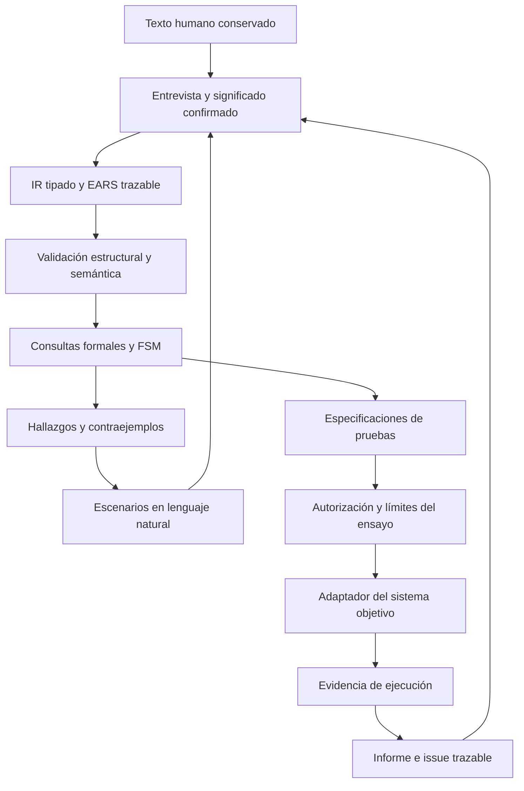

# Propuesta: requisitos, análisis formal e issues trazables

Estado: PROPOSED / DRAFT. Investigación documental; no implementación ni benchmark.
Fecha de referencia del workspace: 2026-10-27. Fuentes vivas, no versiones fijadas.

## Recomendación y criterio

Proponer un monolito modular local en Python, documentos JSON validados con
JSON Schema, Z3 como motor principal y pytest + Hypothesis para ensayos posteriores.
SMT-LIB como exportación de consultas; TLA+/TLC opcional para comportamiento temporal.
Antes de crear un formalizador textual propio, evaluar NASA FRET para la parte
de requisitos temporales: ya cubre elicitación, lenguaje restringido, formalización
y explicación visual. Mantener EARS/español como capa humana; demostrar por casos
la correspondencia con FRETish, sin asumir equivalencia. No hay benchmark de su
interfaz Electron en el equipo objetivo. Su adopción es alternativa de reutilización,
no dependencia obligatoria ni integración ya construida.
No añadir servicios distribuidos, GPU, base vectorial ni modelo local como requisito.
El objetivo es reducir ambigüedad, identificar conflictos y derivar casos trazables;
no certificar que un texto formal representa automáticamente toda intención humana.

Baseline actual: EARS/JSON/FSM y scripts documentales de requerimientos2.3.0,
con contratos semánticos parciales y PRD QA DRAFT. No sustituirlos silenciosamente.
La extensión aquí propuesta no está instalada, aceptada ni habilita producción.
El criterio de elección es integración con lo existente, trazabilidad, mantenimiento
y coste de recursos; no se demuestra que sea la arquitectura óptima universal.

## Comparación de tecnologías open source

| Pieza | Licencia declarada / fuente | Uso propuesto y límite |
| --- | --- | --- |
| NASA FRET | Apache-2.0 declarada para v3 en README [S12] | Candidato prioritario de reutilización para requisitos temporales en inglés restringido FRETish; evaluar antes de desarrollar un formalizador textual propio. FRETish no es EARS ni traducción automática fiable del español. |
| Python | PSF y avisos asociados [S1] | Orquestación, IR tipado y adaptadores. Mantiene un lenguaje con los scripts actuales; tipos estáticos no prueban comportamiento. |
| jsonschema | MIT [S2] | Contrato estructural de JSON. No establece semántica, autoridad ni verdad. |
| Z3 / z3-solver | MIT [S3] | Booleanos, enums y aritmética; buscar modelos/contradicciones. UNKNOWN conserva pendiente. |
| pytest | MIT [S4] | Casos explícitos, parametrización y regresión; el oráculo lo define el requisito. |
| Hypothesis | MPL-2.0 salvo excepciones [S5] | Generación de entradas/secuencias y reducción de casos fallidos. No es exploración exhaustiva ni garantía del mínimo global. |
| Lark | MIT [S6] | Opcional si se necesita sintaxis textual controlada. Parsear EARS no resuelve el significado. Empezar con AST JSON. |
| TLA+ / TLC | Herramientas MIT [S7] | Estados, concurrencia, invariantes y progreso bajo supuestos. Modelo finito y coste de exploración explícitos. |
| cvc5 | BSD-3-Clause; revisar dependencias del paquete [S8] | Segundo solver opcional en el fragmento común SMT-LIB. Concordancia no prueba traducción correcta. |
| pySMT | Apache-2.0 [S9] | Adaptación a varios solvers. Posponer: añade capa antes de necesitar varios motores. |
| Alloy | Open source; archivo raíz dice MIT vigente y contiene texto Apache marcado no vigente [S10] | Alternativa para relaciones/cardinalidades. Revisar licencia del artefacto fijado antes de adoptarlo; no seleccionarlo como dependencia inicial. |

Licencias de proyecto no sustituyen inventario de dependencias y avisos de una
versión distribuida. No se descargaron binarios ni se fijaron versiones aquí.
Python+Z3 resulta la opción inicial por integración, no por benchmark comparativo.
Rust sería candidato para un supervisor separado si los requisitos de aislamiento
y ciclo de vida lo justifican; reescribir el modelador no aporta garantía lógica.
Java permite usar TLC/Alloy sin reimplementar sus motores; no exige mover todo el
producto a Java. TLA+ es lenguaje de especificación; SMT-LIB es intercambio formal,
no sustituyen el lenguaje de interfaz ni el proceso humano.

## Flujo de significado y componentes



Módulos propuestos: ingestión; registro de autoridad; IR; validador; compilador;
consultas solver; explorador de estados; generador de preguntas; catálogo de casos;
ejecutor autorizado separado; registro de evidencia y renderizador de informes.
El núcleo formal debe ser una función de entradas identificadas; los adaptadores
manejan archivos, procesos y red. Ningún texto recibido se evalúa como Python.
Esta separación de núcleo puro y efectos facilita pruebas y límites de confianza;
no constituye aislamiento contra otro proceso con autoridad sobre la misma cuenta.

El LLM propone interpretaciones, preguntas y explicaciones. No aprueba su propia
interpretación ni convierte el silencio en aceptación. El compilador consume
significado suficientemente confirmado, no texto libre como autoridad automática.
Gentle AI orquesta el proceso documental y RDD; la validación formal es un adaptador
nuevo propuesto, no un comando Gentle ya existente.

## Representación intermedia (IR)

Objetos separados con IDs estables: RawUtterance, MeaningConfirmation, Predicate,
DomainConstraint, Requirement, Transition, FormalQuery, Finding, SocraticQuestion,
TestSpecification, ExecutionReceipt, Issue y ReviewReceipt. Cada revisión conserva
sus bytes/hash, relaciones y fuentes; no reescribir la expresión humana original.
Un índice derivado reconstruible evita usar la memoria conversacional como autoridad.

Predicate: id, tipo, dominio, unidad si aplica, observable_ref, definición, estado
de conocimiento y fuente de confirmación. Requirement: id, versión, EARS, modalidad
(debe/puede/prohibido), trigger, precondición, respuesta, temporalidad, excepciones,
fuentes y falsador. Un AST JSON tipado admite and/or/not/implies/eq/le y referencias;
no expresiones arbitrarias. Restricciones de dominio son independientes de reglas
de respuesta: de otra forma una regla puede excluir su propio contraejemplo.

No convertir magnitudes a booleanos antes de definir comparaciones y unidades.
Empezar con booleanos/enums y aritmética lineal sin cuantificadores; dinero con
enteros en unidad acordada o racionales exactos. Limitar tamaños, profundidad y
fragmento soportado; rechazo explícito de operador/tipo/temporalidad no soportados.
No forzar restricciones fuera del fragmento a fórmulas con otro significado.

Desconocimiento epistemológico no es False: se registra aparte de los valores
posibles del dominio. Si un valor no se conoce, el análisis puede explorar todas
sus asignaciones factibles sin afirmar que alguna fue observada. Si el dominio
incluye realmente UNKNOWN como estado de producto, modelarlo con un enum explícito.
Operaciones sensibles sin condición conocida suficiente quedan pendientes según
la política confirmada; no inventar una nueva lógica trivalente universal.

Ejemplo documental, no schema final:

```json
{
  "id": "REQ-EXEC-01",
  "status": "EXAMPLE_NOT_CANONICAL",
  "ears": "Cuando comience una ejecución, deberá existir autorización vigente y recursos suficientes.",
  "domain_constraints_ref": "DOMAIN-01",
  "property": {"op": "implies", "args": [
    {"ref": "execution_started"},
    {"op": "and", "args": [{"ref": "authorization_valid"}, {"ref": "resources_sufficient"}]}
  ]},
  "temporal_note": "Condición necesaria en el inicio; no obliga a ejecutar ni autoriza actividad por sí sola",
  "evidence_status": "NOT_RUN"
}
```

## Consultas que realmente detectan gaps

Sea D el dominio confirmado de entradas/estados, G_i la guarda y O_i la respuesta
exigida por regla i. Cada consulta lleva alcance, revisión y fuentes nombradas.

| Pregunta | Consulta y lectura |
| --- | --- |
| ¿El dominio tiene casos? | SAT(D); si UNSAT, bloquear análisis dependiente para evitar verdad por vacuidad. |
| ¿Hay conflicto local? | Buscar una entrada x factible con G_i(x) y G_j(x) y sin ninguna salida y que satisfaga O_i(x,y) ∧ O_j(x,y). En dominios finitos, fijar cada entrada relevante y consultar compatibilidad de salidas. El test general del conjunto también es necesario: no todo conflicto es de pares. |
| ¿Falta respuesta? | SAT(D ∧ ¬(G_1 ∨ … ∨ G_n)) solo para decisiones que requieren cobertura; una especificación parcial intencional no es fallo automáticamente. |
| ¿Una regla nunca se activa? | UNSAT(D ∧ G_i). Examinar contradicción, supuesto o regla obsoleta; no eliminar por intuición. |
| ¿Un comportamiento viola propiedad P? | SAT(Modelo ∧ ¬P) produce testigo. UNSAT solo respalda la propiedad dentro de ese modelo y lógica. |
| ¿La propiedad pasó sin activar su condición? | Comprobar factibilidad de antecedente y su cobertura; registrar vacuidad. |

SAT en una comprobación de consistencia significa que hay una solución, no que
no existan otros inputs incompatibles: buscar también D(input) ∧ ¬∃output.R(input,output)
con R(x,y)=∧_i(G_i(x)→O_i(x,y)), cuando el fragmento lo soporte, o enumerar
entradas finitas fijando cada x y buscando salida. Este cierre es obligatorio para
declarar ausencia de conflictos y cobertura total en una decisión que las exige;
si no puede completarse, PENDING/INCONCLUSIVE. No afirmar totalidad con una sola
llamada SAT. Una consulta sobre un modelo acotado no acredita otros tamaños.
Falsador documental: con x,y booleanos, guardas verdaderas, O1=(y=false)
y O2=(y=x), x=false admite salida y x=true no. Una consulta SAT global no
detecta por sí sola el hueco de x=true. Ejemplo especificado, NOT_RUN.
Núcleos incompatibles de Z3 no son necesariamente mínimos; minimizar opcionalmente
con presupuesto, sin llamarlos causa raíz ni reescribir requisitos para hacerlos pasar.
SAT/UNSAT/UNKNOWN/TIMEOUT/ERROR son resultados distintos de PASS/FAIL del producto.

Cada hallazgo material se convierte en escenario legible: valores, estado previo,
reglas involucradas, respuesta faltante/incompatible, pregunta y fuentes. La respuesta
humana se añade con vínculo al hallazgo; recompilar y reabrir lo dependiente.
Una restricción que descarta combinación exige fuente confirmada y prueba de su
aplicabilidad; un solver no determina intención ni relevancia de negocio.

## Tablas de verdad, FSM y selección de casos

Enumerar tablas pequeñas para inspección humana; no guardar 2^n filas por defecto.
Para decisiones mayores usar consultas simbólicas y guardar testigos/regiones aún
no analizadas. Restricciones entre particiones se conservan: separar módulos sin
comprobar interfaces puede ocultar conflictos globales.

Sobre FSM, modelar estados/acciones/guardas/efectos, eventos sin transición, reinicio,
invalidación y terminalidad. Distinguir inexistencia de sucesor intencional de un
bloqueo indebido. El desenrollado Z3 hasta k pasos no demuestra propiedades fuera
de k; TLC puede recorrer un modelo finito completo si termina y reporta cobertura.
Para progreso se requieren supuestos temporales/fairness explícitos, no solo safety.
No usar el helper FSM de PERT como verificador universal del modelo del producto.
En la consulta Modelo∧¬P declarar procedencia de Modelo: consecuencia de otros
requisitos, comportamiento modelado por separado o datos del sistema objetivo.
No incluir P por construcción en Modelo y presentar UNSAT como verificación
independiente. Cada resultado conserva esa clase de evidencia.

Casos mínimos propuestos: todas las filas falsas factibles de cada decisión
pequeña, fila positiva con demás condiciones válidas, valores desconocidos, fronteras,
transiciones rechazadas y secuencias que invalidan condiciones. Para sistemas
mayores, MC/DC ayuda a mostrar influencia independiente de condiciones si es factible;
no equivale a cubrir todas las combinaciones. Cobertura por pares es complemento.
Mutaciones del modelo (quitar una guarda) solo son controles negativos etiquetados,
no evidencia de defecto real ni RED TDD inventado.

Un test negativo puede pasar correctamente. RED exige fallo observado y relevante
en la implementación o documento actual, con oráculo previo; después GREEN y
regresión. Ante un fallo generado, conservar input/traza concretos y versiones:
una semilla o un hash aislados no garantizan reproducción entre versiones.

## Evitar que el mismo error genere requisito, test y aprobación

El compilador y el generador de pruebas comparten IR: podrían compartir un error.
Mitigar con ejemplos revisados manualmente, intérprete independiente del IR para
subconjuntos pequeños, comparación tabla↔solver y revisión de traducción al lenguaje
natural por humano. Un segundo solver solo contrasta la fórmula que recibió.
Hypothesis compara el adaptador real con un modelo acordado, no con la misma
función llamada dos veces. RDD documental no sustituye reproducción independiente.
Para esa reproducción, registrar ejecutor, entorno, código de prueba, entradas,
comandos, códigos de salida y artefactos; diferenciar proceso distinto de máquina
o principal independiente. Un supervisor futuro debe cubrir descendientes y
recuperación si termina el coordinador; un timeout dentro del hijo no basta para
asegurar ese requisito. No diseñar esta propuesta como implementación ya endurecida.

## Issues y cambios

Issue: snapshot/model_version, requirement_refs, predicate_values con procedencia,
estado/traza, expected, observed, evidence_ref, environment, versions y scope.
Un issue sin evidencia se registra como reporte/hipótesis, no defecto confirmado.
Distinguir fallo de implementación, requisito ambiguo, modelo incorrecto y oráculo
incorrecto. No cambiar el resultado esperado solo para volver GREEN.
Grafo de trazabilidad con aristas tipadas, no solo enlaces de texto:
texto→significado→regla→consulta→caso→ejecución→issue→corrección→revisión.
Un cambio invalida las conclusiones dependientes; si la independencia no está
justificada, invalidación conservadora del alcance afectado, sin borrar historia.

## Recursos y viabilidad

Objetivo declarado: i3-3240, 8GB físicos; WSL6GB, zram2GB y swap8GB. No medido.
Zram y swap no convierten ese entorno en 16GB de RAM física; no usarlas como
presupuesto ordinario del solver. Empezar con un trabajador, CLI, dependencias
binarias compatibles fijadas y proyectos dentro del filesystem Linux de WSL cuando
corresponda. Sin garantía de prestaciones ni compatibilidad ISA de un wheel concreto.
Probar compatibilidad y licencias de la versión seleccionada antes de instalarla.

Presupuestos de memoria/tiempo/estados por confirmar mediante piloto autorizado;
ningún número de este diseño es un límite humano aprobado. Deadline del motor,
control exterior y límites de entrada son controles distintos. TIMEOUT conserva
pendiente; no aumentar recursos automáticamente ni producir PASS parcial global.
Registrar versión, parámetros, orden, semillas aplicables, entorno, query y modelo;
no exigir que dos solvers produzcan el mismo testigo ni el mismo núcleo incompatible.
Las métricas iniciales: memoria pico, duración, estados/casos cubiertos y tiempo de
reproducción. No ejecutarlas ahora: encargo actual documental, sin instalaciones.

## Plan de adopción y criterios de aceptación

DAG propuesto: A registro semántico → B contrato IR → C consultas/tabla → E preguntas
→ F especificaciones de pruebas. D modelo temporal depende de B y alimenta E.
G adaptador experimental depende de F y autorización específica; H reproducción y
revisión depende de G. Cambios posteriores crean revisión, no borran la anterior.
Matriz directa (filas/columnas A B C D E F G H):

| | A | B | C | D | E | F | G | H |
|---|---|---|---|---|---|---|---|---|
| A |0|1|0|0|0|0|0|0|
| B |0|0|1|1|0|0|0|0|
| C |0|0|0|0|1|0|0|0|
| D |0|0|0|0|1|0|0|0|
| E |0|0|0|0|0|1|0|0|
| F |0|0|0|0|0|0|1|0|
| G |0|0|0|0|0|0|0|1|
| H |0|0|0|0|0|0|0|0|

Duraciones desconocidas: TOPOLOGY_ONLY, sin ruta crítica ni fechas calculadas.
D es rama condicional si hay comportamiento temporal; su ausencia requiere razón.
Estado de actividad: PROPOSED→SPECIFIED→AUTHORIZED→RUNNING→EVIDENCED→REVIEWED;
RUNNING puede terminar BLOCKED/FAILED, sin transición a REVIEWED sin evidencia.
La FSM del producto es distinta de esta FSM de trabajo y de permisos del runtime.

Aceptación futura: tablas pequeñas y solver concuerdan; dominio vacío no obtiene
PASS; obligaciones parciales no se pierden; UNKNOWN/timeout no cierra; tres obligaciones simultáneas
incompatibles se detectan aunque pares sean compatibles (guardas verdaderas,
y∈{0,1,2}, obligaciones y≠0, y≠1, y≠2); un cambio de modelo vuelve
STALE la evidencia afectada; un caso descubierto se conserva como regresión;
la comparación con sistema real no reusa el mismo oráculo como implementación.
Falsador del diseño: permite aprobar una obligación desconocida, pierde una fila
factible o usa una inferencia del LLM como confirmación humana sin fuente.

## Deuda y decisiones pendientes

EP-01: quién confirma suficiencia semántica, materialidad y alcance sigue abierto.
EP-02: fragmento/dominios y temporalidad específicos dependen del caso seleccionado.
AS-01: benchmark en equipo objetivo y reproducción independiente no realizados.
TE-01: adaptadores de solver/ensayos/supervisor no implementados.
LI-01: versiones, avisos transitivos y contrato Alloy por artefacto pendientes.
Impacto: impiden presentar implementación/READY/garantías de producción; no impiden
entregar esta propuesta. Reabrir antes de autorizar piloto/instalación/adopción.
No se aprueba deuda por RDD ni se acepta riesgo residual por silencio.

## Evidencia de investigación

MCP Context7: /microsoft/z3guide consultado para cores y límites; fuentes primarias
web contrastadas. CodeGraph omitido por ausencia de índice según AGENTS.md.
Referencias cloud architecture-evidence/integrated-contract no accesibles en esta
sesión; no se afirma cierre completo de esas skills. Engram es historia, no autoridad.
La selección se apoya en documentación, no ensayos de prestaciones. Fuentes en FUENTES.md.
